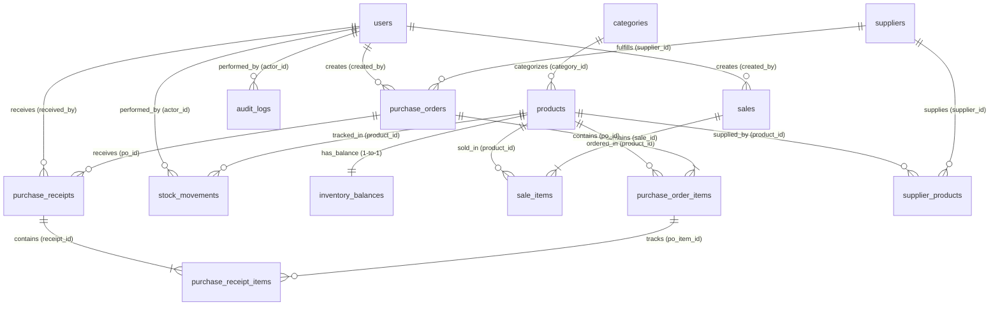

# StockPilot Entity Relationship Diagram (ERD) & Data Dictionary

## 1. Visual Entity Relationship Diagram

---

## 2. Cardinality Contracts

* **Category 1 ── N Products**: Every product belongs to an active category.
* **Product 1 ── 1 InventoryBalance**: Single-location MVP ensures exactly one current on-hand counter per SKU.
* **Product N ── N Suppliers** (via `supplier_products`): A product can have multiple vendor sources with specific quoted costs, lead times, and a `is_preferred` flag.
* **Sale 1 ── N SaleItems**: Each item snapshots `unit_price` at time of sale.
* **PurchaseOrder 1 ── N PurchaseOrderItems**: Tracks `ordered_qty` and cumulative `received_qty`.
* **PurchaseOrder 1 ── N PurchaseReceipts**: Supports partial deliveries until total `received_qty == ordered_qty`.
* **PurchaseReceipt 1 ── N PurchaseReceiptItems**: Per-item breakdown of received quantities linked to original PO lines.
* **Product 1 ── N StockMovements**: Immutable ledger entries tracking all changes (`delta`, `movement_type`, `reference_type`, `reference_id`, `actor_id`).

---

## 3. Detailed Data Dictionary

### 3.1 `users`
| Column | Type | Constraints / Attributes | Description |
| :--- | :--- | :--- | :--- |
| `id` | BIGINT | PRIMARY KEY, AUTO_INCREMENT | Unique user identifier |
| `name` | VARCHAR(100) | NOT NULL | User's full name |
| `email` | VARCHAR(150) | UNIQUE, NOT NULL | Login email address |
| `password_hash` | VARCHAR(255) | NOT NULL | Argon2 / Bcrypt password hash |
| `role` | ENUM | NOT NULL (`ADMIN`, `INVENTORY_MANAGER`, `SALES_STAFF`) | Predefined access role |
| `is_active` | BOOLEAN | DEFAULT TRUE | Soft disable flag |
| `created_at` | DATETIME(3) | DEFAULT CURRENT_TIMESTAMP(3) | Creation timestamp (UTC) |

### 3.2 `categories`
| Column | Type | Constraints / Attributes | Description |
| :--- | :--- | :--- | :--- |
| `id` | BIGINT | PRIMARY KEY, AUTO_INCREMENT | Category ID |
| `name` | VARCHAR(100) | UNIQUE, NOT NULL | Category name (e.g. Cables, Adapters) |
| `description` | TEXT | NULLABLE | Detailed description |
| `created_at` | DATETIME(3) | DEFAULT CURRENT_TIMESTAMP(3) | Creation timestamp |

### 3.3 `products`
| Column | Type | Constraints / Attributes | Description |
| :--- | :--- | :--- | :--- |
| `id` | BIGINT | PRIMARY KEY, AUTO_INCREMENT | Product ID |
| `sku` | VARCHAR(50) | UNIQUE, NOT NULL | Stock Keeping Unit code |
| `name` | VARCHAR(150) | NOT NULL | Product title |
| `category_id` | BIGINT | FK -> `categories(id)`, NOT NULL | Category classification |
| `cost_price` | DECIMAL(12,2) | NOT NULL, >= 0 | Standard unit cost |
| `sell_price` | DECIMAL(12,2) | NOT NULL, >= 0 | Retail selling price |
| `reorder_level` | INT | NOT NULL, DEFAULT 10 | Minimum stock alert threshold |
| `is_active` | BOOLEAN | DEFAULT TRUE | Soft disable flag |
| `created_at` | DATETIME(3) | DEFAULT CURRENT_TIMESTAMP(3) | Creation timestamp |

### 3.4 `inventory_balances`
| Column | Type | Constraints / Attributes | Description |
| :--- | :--- | :--- | :--- |
| `id` | BIGINT | PRIMARY KEY, AUTO_INCREMENT | Balance ID |
| `product_id` | BIGINT | UNIQUE, FK -> `products(id)`, NOT NULL | Product reference |
| `on_hand` | INT UNSIGNED | NOT NULL, DEFAULT 0 | Current physically available units |
| `updated_at` | DATETIME(3) | ON UPDATE CURRENT_TIMESTAMP(3) | Last update timestamp |

### 3.5 `suppliers`
| Column | Type | Constraints / Attributes | Description |
| :--- | :--- | :--- | :--- |
| `id` | BIGINT | PRIMARY KEY, AUTO_INCREMENT | Supplier ID |
| `name` | VARCHAR(150) | NOT NULL | Vendor company name |
| `email` | VARCHAR(150) | NULLABLE | Vendor contact email |
| `phone` | VARCHAR(50) | NULLABLE | Vendor phone number |
| `default_lead_days` | INT | NOT NULL, DEFAULT 7 | Expected delivery lead time in days |
| `is_active` | BOOLEAN | DEFAULT TRUE | Active vendor flag |
| `created_at` | DATETIME(3) | DEFAULT CURRENT_TIMESTAMP(3) | Creation timestamp |

### 3.6 `supplier_products`
| Column | Type | Constraints / Attributes | Description |
| :--- | :--- | :--- | :--- |
| `id` | BIGINT | PRIMARY KEY, AUTO_INCREMENT | Link ID |
| `supplier_id` | BIGINT | FK -> `suppliers(id)`, NOT NULL | Supplier reference |
| `product_id` | BIGINT | FK -> `products(id)`, NOT NULL | Product reference |
| `unit_cost` | DECIMAL(12,2) | NOT NULL | Agreed vendor purchase cost |
| `lead_days` | INT | NOT NULL | Supplier-specific lead time |
| `is_preferred` | BOOLEAN | DEFAULT FALSE | Default preferred vendor indicator |
| *Index* | UNIQUE | `(supplier_id, product_id)` | Prevents duplicate supplier-SKU pairs |

### 3.7 `stock_movements`
| Column | Type | Constraints / Attributes | Description |
| :--- | :--- | :--- | :--- |
| `id` | BIGINT | PRIMARY KEY, AUTO_INCREMENT | Movement ID |
| `product_id` | BIGINT | FK -> `products(id)`, NOT NULL | Product reference |
| `delta` | INT (SIGNED) | NOT NULL | Positive (increase) or negative (decrease) |
| `movement_type` | ENUM | NOT NULL | `OPENING_IN`, `PURCHASE_IN`, `SALE_OUT`, `ADJUST_IN`, `ADJUST_OUT`, `SALE_VOID_IN` |
| `reference_type` | VARCHAR(50) | NOT NULL | Source entity (`SALE`, `PURCHASE_ORDER`, `MANUAL_ADJUSTMENT`) |
| `reference_id` | BIGINT | NOT NULL | Source entity ID |
| `reason` | VARCHAR(255) | NULLABLE | Mandatory for manual adjustments |
| `actor_id` | BIGINT | FK -> `users(id)`, NOT NULL | User who initiated the operation |
| `created_at` | DATETIME(3) | DEFAULT CURRENT_TIMESTAMP(3) | Immutable timestamp |

### 3.8 `sales`
| Column | Type | Constraints / Attributes | Description |
| :--- | :--- | :--- | :--- |
| `id` | BIGINT | PRIMARY KEY, AUTO_INCREMENT | Sale ID |
| `sale_number` | VARCHAR(50) | UNIQUE, NOT NULL | Human-readable receipt number (e.g. `SAL-2026-0001`) |
| `created_by` | BIGINT | FK -> `users(id)`, NOT NULL | Staff member who made the sale |
| `subtotal` | DECIMAL(12,2) | NOT NULL | Total transaction monetary value |
| `status` | ENUM | NOT NULL (`COMPLETED`, `VOID`) | Transaction state |
| `created_at` | DATETIME(3) | DEFAULT CURRENT_TIMESTAMP(3) | Sale timestamp |
| `voided_at` | DATETIME(3) | NULLABLE | Void timestamp if cancelled |

### 3.9 `sale_items`
| Column | Type | Constraints / Attributes | Description |
| :--- | :--- | :--- | :--- |
| `id` | BIGINT | PRIMARY KEY, AUTO_INCREMENT | Item ID |
| `sale_id` | BIGINT | FK -> `sales(id)`, NOT NULL | Parent sale reference |
| `product_id` | BIGINT | FK -> `products(id)`, NOT NULL | Product reference |
| `quantity` | INT | NOT NULL, > 0 | Units sold |
| `unit_price` | DECIMAL(12,2) | NOT NULL | Price snapshot at time of sale |
| `line_total` | DECIMAL(12,2) | NOT NULL | `quantity * unit_price` |

### 3.10 `purchase_orders`
| Column | Type | Constraints / Attributes | Description |
| :--- | :--- | :--- | :--- |
| `id` | BIGINT | PRIMARY KEY, AUTO_INCREMENT | PO ID |
| `po_number` | VARCHAR(50) | UNIQUE, NOT NULL | PO Number (e.g. `PO-2026-0001`) |
| `supplier_id` | BIGINT | FK -> `suppliers(id)`, NOT NULL | Target vendor |
| `status` | ENUM | NOT NULL (`DRAFT`, `SUBMITTED`, `PARTIAL`, `RECEIVED`, `CANCELLED`) | Lifecycle status |
| `expected_at` | DATETIME(3) | NULLABLE | Calculated delivery arrival |
| `created_by` | BIGINT | FK -> `users(id)`, NOT NULL | User who created the PO |
| `created_at` | DATETIME(3) | DEFAULT CURRENT_TIMESTAMP(3) | Creation timestamp |

### 3.11 `purchase_order_items`
| Column | Type | Constraints / Attributes | Description |
| :--- | :--- | :--- | :--- |
| `id` | BIGINT | PRIMARY KEY, AUTO_INCREMENT | Item ID |
| `po_id` | BIGINT | FK -> `purchase_orders(id)`, NOT NULL | Parent PO reference |
| `product_id` | BIGINT | FK -> `products(id)`, NOT NULL | Product reference |
| `ordered_qty` | INT | NOT NULL, > 0 | Total units ordered |
| `received_qty` | INT | NOT NULL, DEFAULT 0 | Cumulative units received |
| `unit_cost` | DECIMAL(12,2) | NOT NULL | Cost snapshot at time of PO creation |

### 3.12 `purchase_receipts`
| Column | Type | Constraints / Attributes | Description |
| :--- | :--- | :--- | :--- |
| `id` | BIGINT | PRIMARY KEY, AUTO_INCREMENT | Receipt ID |
| `po_id` | BIGINT | FK -> `purchase_orders(id)`, NOT NULL | Target PO reference |
| `receipt_key` | VARCHAR(100) | UNIQUE, NOT NULL | Client idempotency key preventing duplicate posting |
| `received_by` | BIGINT | FK -> `users(id)`, NOT NULL | Staff who accepted shipment |
| `received_at` | DATETIME(3) | DEFAULT CURRENT_TIMESTAMP(3) | Receipt timestamp |

### 3.13 `purchase_receipt_items`
| Column | Type | Constraints / Attributes | Description |
| :--- | :--- | :--- | :--- |
| `id` | BIGINT | PRIMARY KEY, AUTO_INCREMENT | Receipt line ID |
| `receipt_id` | BIGINT | FK -> `purchase_receipts(id)`, NOT NULL | Parent receipt reference |
| `po_item_id` | BIGINT | FK -> `purchase_order_items(id)`, NOT NULL | Original PO line reference |
| `received_qty` | INT | NOT NULL, > 0 | Quantity delivered in this shipment |

### 3.14 `audit_logs`
| Column | Type | Constraints / Attributes | Description |
| :--- | :--- | :--- | :--- |
| `id` | BIGINT | PRIMARY KEY, AUTO_INCREMENT | Audit ID |
| `actor_id` | BIGINT | FK -> `users(id)`, NOT NULL | Performing user ID |
| `entity_type` | VARCHAR(50) | NOT NULL | Entity name (`USER`, `PRODUCT`, `STOCK`, `PO`, `SALE`) |
| `entity_id` | BIGINT | NOT NULL | Entity ID |
| `action` | VARCHAR(50) | NOT NULL | Action type (`CREATE`, `UPDATE`, `VOID`, `ADJUST`, `RECEIVE`) |
| `before_json` | JSON | NULLABLE | State prior to modification |
| `after_json` | JSON | NULLABLE | State after modification |
| `created_at` | DATETIME(3) | DEFAULT CURRENT_TIMESTAMP(3) | Immutable timestamp |
